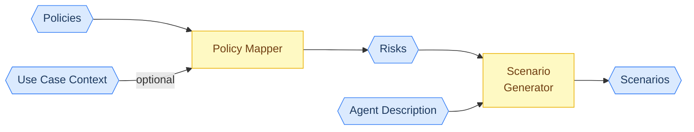
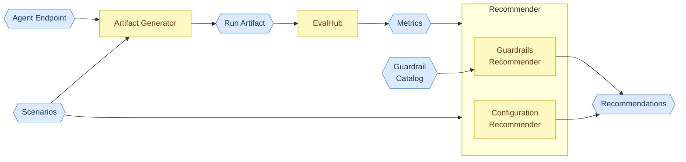

## asago

asago (AI Safety And Governance Orchestration) is an open-source community that aims to automate the journey from AI
governance policy to production-ready, safely deployed AI systems — bridging the gap between compliance teams, AI
engineers, and infrastructure operators.

The asago project is in its formation stage, however you can check in on our development at the repos below. As we
release more, they will be added below.

Find out more about asago at https://asago.ai

### High Level Architecture

Asago turns AI governance policies into concrete tests, runs those tests against an agent, and recommends fixes.

The pipeline has two stages. The first stage reads your policies and produces test scenarios. The second stage evaluates an agent against those scenarios and recommends guardrails or configuration changes.

#### From policies to scenarios

The `Policy Mapper` reads your policy documents and produces a set of risks. The `Scenario Generator` then turns each risk into a technology-agnostic test scenario, based on the agent capabilities.

> **Blue** nodes represent data. **Yellow** nodes represent functional components.

#### Agent evaluation

The `Artifact Generator` turns the scenarios into framework-specific test artifacts, through the `Midojo` and `Garak` adapters. `EvalHub` runs these tests against the agent endpoint and produces metrics. The `Recommender` then reviews the results and produces guardrail or configuration recommendations.

The user applies the recommendations and re-runs the evaluation against the same scenarios. This loop continues until all risks pass.

> **Blue** nodes represent data. **Yellow** nodes represent functional components.

### Core Components

| Repo                                                                       | Description                                                                                                                                                                |
|----------------------------------------------------------------------------|----------------------------------------------------------------------------------------------------------------------------------------------------------------------------|
| [Policy Mapper](https://github.com/asago-ai/asago-policy-mapper)           | Reads your AI policy documents and produces a structured list of identified AI risks, with evidence and cross-taxonomy mappings. Use by future downstream asago components |
| [Scenario Generator](https://github.com/asago-ai/asago-scenario-generator) | Translates the identified risks into technology-agnostic test scenarios, based on the agent capabilities. Consumed by downstream asago components.                         |
| [Artifact Generator](https://github.com/asago-ai/asago-artifact-generator) | Translates the test scenarios into framework-specific test artifacts through the Midojo and Garak adapters.                                                                |

### Supporting & Experimental Components

| Repo                                                                                        | Description                                                                                                                                                                                                          |
|---------------------------------------------------------------------------------------------|----------------------------------------------------------------------------------------------------------------------------------------------------------------------------------------------------------------------|
| [Garak (fork)](https://github.com/trustyai-explainability/garak/tree/automated-red-teaming) | Midstream fork of Nvidia Garak for automated red-teaming of LLMs. Used as an adapter by the Artifact Generator.                                                                                                      |
| [Midojo](https://github.com/asago-ai/midojo)                                                | Red-teams AI agents by hiding malicious payloads in the data they fetch, testing whether the agent takes harmful actions as a side effect of doing legitimate work. Will be orchestrated by future asago components. |

### Examples

| Repo                                                   | Description                                                 |
|--------------------------------------------------------|-------------------------------------------------------------|
| [Examples](https://github.com/asago-ai/asago-examples) | Jupyter notebooks to get you started with asago components. |